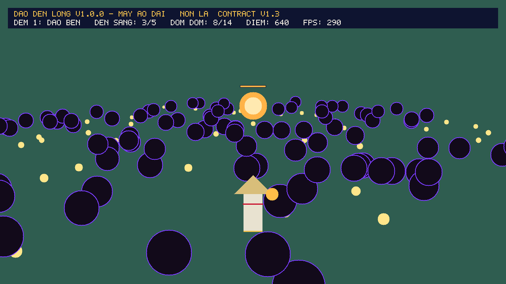

# Đảo Đèn Lồng v1.0.0 — Day 12 AI SDLC (Contract v1.3)

> **Video demo (< 5 phút):** [docs/demo/demo.mp4](docs/demo/demo.mp4) · **Bản phát hành:** [GitHub Release `v1.0.0`](https://github.com/huy9ai/K5-L3A-DAY12-BuiGiaHuy-2A202603525-AI-SDLC-Dao-Den-Long/releases/tag/v1.0.0)



Game 3D góc nhìn thứ ba: **Mây** trong tà **Áo Dài truyền thống Việt Nam & Nón Lá** mang đèn lồng nhỏ, vượt qua chuỗi **3 Đêm** trên ba hòn đảo (**Đêm 1 — Đảo Bến**, **Đêm 2 — Đảo Cau**, **Đêm 3 — Đảo Chuông**) thu thập đom đóm, thắp sáng & châm dầu cho các Đèn Lồng Lớn, ngăn **Bóng Mực** hút dầu, đối phó **Gió Lạc** & gió mạnh và giữ đủ đèn sáng tới tận bình minh.

---

## Yêu cầu hệ thống & Cài đặt (≤ 3 lệnh)

- **Yêu cầu hệ thống:** **Python 3.10+** (không cần `npm`, không cần `pip install`, dùng 100% Python 3 Standard Library; hỗ trợ **macOS, Linux và Windows**) cùng một trình duyệt hỗ trợ **WebGL2** (Chrome, Edge, Firefox, Safari).

```bash
git clone https://github.com/huy9ai/K5-L3A-DAY12-BuiGiaHuy-2A202603525-AI-SDLC-Dao-Den-Long.git
cd K5-L3A-DAY12-BuiGiaHuy-2A202603525-AI-SDLC-Dao-Den-Long
python3 run.py
```

*(Trên Windows có thể dùng `python run.py`, sau đó mở trình duyệt tại `http://127.0.0.1:8000`. Chạy qua Docker: `docker build -t dao-den-long . && docker run -p 8000:8000 dao-den-long`.)*

---

## Điều khiển & Dễ tiếp cận (Accessibility)

Mọi phím dưới đây đều có thể **đổi phím tùy ý** trong **Cài đặt & Đổi phím** (có tự động phát hiện trùng phím, nút **Khôi phục mặc định** và lưu bền trong `localStorage`):

| Phím mặc định | Chức năng |
|---|---|
| `W` `A` `S` `D` / `↑` `↓` | Di chuyển theo hướng camera (`D` qua phải, `A` qua trái) |
| `Space` | Nhảy (`7.0 m/s`, khi đứng trên mặt đất) |
| `Shift` hoặc Chuột phải | Lướt nhanh (`14.0 m/s` trong `0.2 s`, hồi `1.5 s`, giữ nguyên độ cao khi lướt trên không) |
| `E` hoặc `F` | Thắp đèn (`10` lần đầu / `5` thắp lại) hoặc **Châm dầu** cho đèn đang sáng chưa đầy (`+10` dầu/đom đóm) |
| `Q` | Tỏa Sáng xua Bóng Mực & Gió Lạc (tốn `3` đom đóm, bán kính 3D `5.0 m`, hồi `3.0 s`; `+15` điểm nếu trúng Bóng Mực đang hút dầu) |
| Kéo chuột hoặc `←` `→` / Cuộn chuột | Xoay và phóng gần/xa camera góc nhìn thứ ba |
| `P` hoặc `Esc` | Tạm dừng game (Tiếp tục / Chơi lại Đêm / Cài đặt & Đổi phím / Về Menu) |

### Tính năng Dễ tiếp cận (Accessibility — Phase 4)
- **Đổi phím 9 hành động:** Tiến, lùi, trái, phải, nhảy, lướt, tương tác, tỏa sáng, tạm dừng; tự động báo lỗi khi trùng phím và có nút **Khôi phục mặc định**.
- **Phụ đề & chỉ báo hình ảnh:** Hiển thị phụ đề cảnh báo cho **Bóng Mực xuất hiện** (kèm **mũi tên chỉ hướng ở mép màn hình**), **gió sắp thổi**, **10 giây cuối**, và **đèn có `fuel < 30`**.
- **Bảng màu dễ phân biệt (Mù màu):** Đổi viền & mắt Bóng Mực sang `#00B3FF`, cảnh báo UI sang `#FFFFFF` + `⚠`, đèn tắt xẹp `20%` kèm vết rách giấy, thanh dầu + đèn `< 30` nhấp nháy `1 Hz`.
- **Giảm chuyển động:** Tắt hoàn toàn rung camera, chớp màn hình và hiệu ứng nhấp nháy nhanh.
- **Cỡ chữ UI:** Tối thiểu **`18 px`** ở độ phân giải `1280×720`, kèm tùy chọn **Chữ lớn (`×1.25` = `22.5 px`)**.

---

## Cách chạy Kiểm chứng, Headless, Benchmark, Soak & Bảng xếp hạng (Test Contract v1.3)

Toàn bộ lệnh chuẩn được khai báo trong [game.contract.json](game.contract.json) (`contract_version: "1.3"`):

```bash
# 1. Kiểm chứng tổng (Contract v1.3, 31 unit/integration tests, 5x SHA-256, bench/soak check, 21.600-tick benchmark)
python3 scripts/verify.py

# 2. Chạy bộ test với pytest (tùy chọn)
pytest -v

# 3. Chế độ Headless (Đêm 1, 2 hoặc 3)
python3 run.py headless --seed 42 --night 1 --ticks 600 --out /tmp/out_n1.jsonl
python3 run.py headless --seed 42 --night 2 --ticks 600 --out /tmp/out_n2.jsonl
python3 run.py headless --seed 42 --night 3 --ticks 18000 --out /tmp/out_n3.jsonl

# 4. Chế độ Benchmark chuẩn 1280x720 (200 Bóng Mực wander, 100 đom đóm, 3 đèn sáng L1-L3, 3s warmup + 30s đo)
python3 run.py bench --seed 42 --duration 30 --out bench.json

# 5. Chế độ Soak Test (10 Đêm liên tiếp xoay vòng 1->2->3 trong cùng tiến trình, đo RSS mem_start_mb / mem_end_mb)
python3 run.py soak --seed 7 --nights 10 --out soak.json

# 6. Xuất Bảng xếp hạng cục bộ Top 10 ra JSON
python3 run.py --export-leaderboard out.json
```

> **Ghi chú về VSync trong chế độ Benchmark:** Khi chạy `run.py bench` với trình duyệt Chromium/Chrome/Edge, tiến trình tự truyền cờ `--window-size=1280,720 --disable-frame-rate-limit --disable-gpu-vsync` và vòng lặp `setTimeout(..., 0)` để tắt giới hạn VSync (`"vsync_off": true`). Nếu mở thủ công trên trình duyệt khoá cứng VSync theo hệ điều hành, FPS có thể bị trần ở tần số quét màn hình.

---

## Luật chơi & Thông số chuẩn (`game.contract.json` v1.3)

- **3 Đêm Bình Minh:** Đêm 1 Đảo Bến (`240 s`, giữ `≥ 3/5` đèn sáng) · Đêm 2 Đảo Cau (`270 s`, giữ `≥ 4/6` đèn sáng, cầu tre, 2 bục nhảy, Bùa Gió, Gió Lạc) · Đêm 3 Đảo Chuông (`300 s`, giữ `≥ 5/7` đèn sáng, 3 tầng, 2 dốc, bục nhảy, tháp chuông, gió mạnh mỗi `30 s`).
- **Nhiên liệu đèn & Bóng Mực hút dầu (`drain`):** Đèn vừa thắp có `fuel = 100`, tự hao `1.0/s` (đơn vị nguyên `1/60`). Đèn tắt khi `fuel <= 0` (`lantern_out`, nhớ `ever_lit = true`, thắp lại tốn `5` đom đóm). Đèn `fuel < 30` mất vùng an toàn `6 m`; Bóng Mực `wander` tiến vào `<= 2 m` chuyển sang `drain` hút `5/s` cộng dồn (`fuel_drain` mỗi 60 tick). Châm dầu lên `>= 30` đẩy Bóng Mực ra mép `6 m` trong `<= 30` tick.
- **Sức chứa tăng dần & Bảng điểm:** Sức chứa `min(20, 10 + 2 × successful_lights)`. Điểm: `+5`/đom đóm nạp, `+100` thắp lần đầu, `+40` thắp lại, `+5` Tỏa Sáng Bóng Mực (`+15` nếu đang `drain`), thưởng thắng Bình minh `+50 + floor(fuel)` mỗi đèn sáng + `+50` mỗi Ngọn Lửa còn lại.
- **Bảng xếp hạng cục bộ Top 10:** Lưu tại `data/leaderboard.json`, cho phép nhập tên (`3–12` ký tự `[A-Za-z0-9_]` hoặc tiếng Việt) sau khi thắng Đêm 3 hoặc thua ở bất kỳ Đêm nào; sắp xếp theo `score` giảm dần (bằng điểm ai đạt trước đứng trên).

---

## Sáng tạo của tôi

Mọi phần sáng tạo nằm riêng tại tầng hiển thị & âm thanh (`src/dao_den_long/web/`), **tự động tắt trong cảnh Benchmark & Soak Test** và **không làm thay đổi bất kỳ byte nào của đầu ra chế độ headless**:
- **Mây mặc Áo Dài truyền thống Việt Nam & Nón Lá (`drawMayAoDai`):** Tạo hình Mây bằng WebGL2 với thân Áo Dài cổ đứng trắng ngà (`#E8E2D0`), hai tà áo trước/sau viền vàng (`#F2C14E`) phấp phới theo bước chạy, quần lụa rộng, khăn lụa đỏ (`#C8102E`), búi tóc và chiếc **Nón Lá** vàng tre treo lồng đèn giấy mini đung đưa phía trước.
- **Ánh sáng điểm động & Bầu trời đêm cổ tích:** Shader GLSL ES 3.00 tính ánh sáng điểm vàng ấm từ tối đa 7 Đèn Lồng Lớn đang sáng, sương mù đêm theo khoảng cách, bầu trời 60 ngôi sao + trăng khuyết, vách đá đảo nổi và rặng tre ven Đảo Bến (tự động tắt sao/trăng/tre khi chạy `?mode=bench` để giữ cảnh đo chuẩn).
- **Đom đóm bay 2 vòng đồng tâm & Âm thanh Web Audio API:** Đom đóm bay quanh Mây mở rộng lên 2 vòng khi sức chứa tăng `10 → 20`, kết hợp nhạc nền đêm và 12 hiệu ứng âm thanh procedural.
- **Bằng chứng không phá Test Contract:** Toàn bộ **31/31 test** và 5 kịch bản SHA-256 trong [docs/proof/phase-4/verify-output.txt](docs/proof/phase-4/verify-output.txt) xác nhận tuân thủ 100% Contract v1.3.

---

## Tài liệu SDLC, Bằng chứng & Harness AI

- **Số đo Benchmark & Soak đã commit:** [bench.json](bench.json) · [soak.json](soak.json)
- **Harness AI & CI:** [AGENTS.md](AGENTS.md), [.agents/skills/](.agents/skills/), [.githooks/pre-commit](.githooks/pre-commit), [.claude/settings.json](.claude/settings.json), [.github/workflows/ci.yml](.github/workflows/ci.yml)
- **Ghi chép SDLC & Retro:** [retro.md](docs/notes/retro.md), [assumptions.md](docs/notes/assumptions.md), [decisions.md](docs/notes/decisions.md) (ADR-001..006), [ai-log.md](docs/notes/ai-log.md)
- **Bằng chứng kiểm chứng 4 Phase:** [Phase 4 Proof](docs/proof/phase-4/README.md) · [Phase 3 Proof](docs/proof/phase-3/README.md) · [Phase 2 Proof](docs/proof/phase-2/README.md) · [Phase 1 Proof](docs/proof/phase-1/README.md) · [CP0 Proof](docs/proof/cp0/README.md)
- **Bản quyền & Nguồn:** [LICENSE](LICENSE), [CREDITS.md](CREDITS.md), [CHANGELOG.md](CHANGELOG.md), [LAB_SPEC.md](docs/LAB_SPEC.md)
